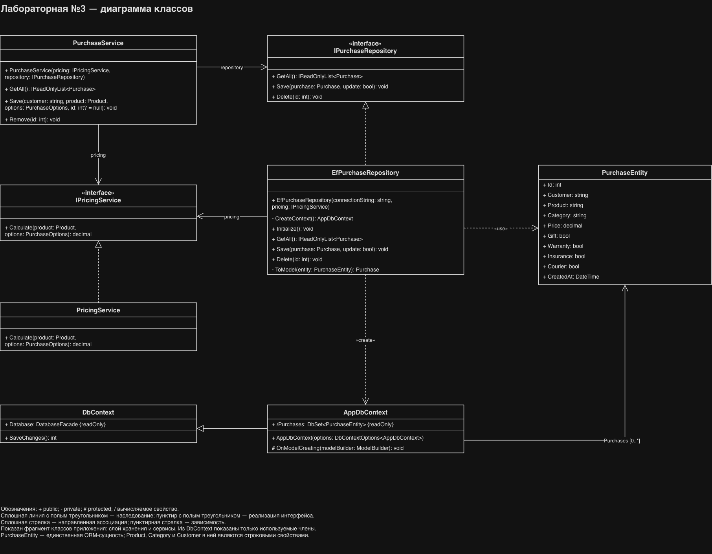
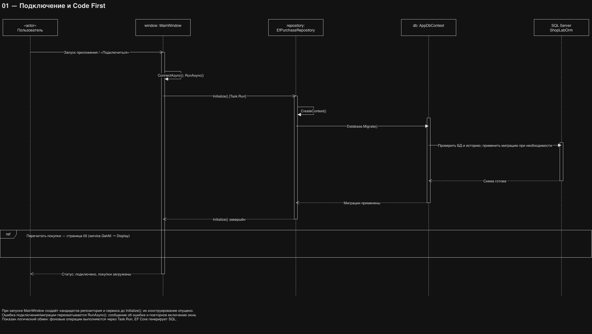

# Лабораторная №3 — интернет-магазин с ORM

Вариант 2. C# 12, WPF, .NET 8 (`net8.0-windows`), Entity Framework Core SQL Server **8.0.22**, Code First. Ветка `lab3` продолжает `lab2`; предыдущие лабораторные доступны в `lab1` и `lab2`.

[Код lab3](https://github.com/pirate2403/ShopApp/tree/lab3) · [Макет Figma](https://www.figma.com/design/I5L1IMwSMjMteNFit0vpaG?node-id=2-2) · [Отчёт](docs/Отчёт_ЛР3.md)

## Запуск на Windows

1. Нужны Visual Studio с «Разработкой классических приложений .NET», SDK .NET 8 и SQL Server Express LocalDB (например, версия 2022).
2. Откройте **ShopApp.csproj в корне**, назначьте ShopApp запускаемым проектом. ShopApp.Checks — консольные проверки.
3. Восстановите зависимости и нажмите F5 или Ctrl+F5.
4. При первом подключении EF Core создаст **ShopLabOrm** и применит начальную миграцию. Базу вручную создавать и выполнять Setup.sql из лабораторной №2 не нужно. Пользователю SQL Server требуются права создания базы и таблиц.

```powershell
git fetch origin
git switch lab3
dotnet restore ShopApp.csproj
dotnet run --project ShopApp.csproj --no-restore
```

Для клонирования после публикации ветки:

```powershell
git clone --branch lab3 https://github.com/pirate2403/ShopApp.git
cd ShopApp
```

Строка подключения в верхнем поле:

```text
Server=(localdb)\MSSQLLocalDB;Database=ShopLabOrm;Integrated Security=True;Encrypt=True;TrustServerCertificate=True;Connect Timeout=5
```

Для SQL Server Express замените сервер на `.\SQLEXPRESS`. Нажмите «Подключиться / обновить». Строка не сохраняется на диск; пароль отсутствует. TrustServerCertificate предназначен для локального учебного запуска.

База второй лабораторной ShopLab не изменяется. Данные из неё автоматически не переносятся. Не направляйте приложение на старую базу: структура создаётся Code First для отдельной БД.

## Работа

Введите имя, выберите товар, услуги и доставку, нажмите «Добавить покупку». Выберите строку для изменения; отредактируйте поля и нажмите «Сохранить изменения». Удаление требует подтверждения. После CRUD список перечитывается из SQL Server. Очистка формы не удаляет покупки.

Расчёт: цена товара + упаковка 200 ₽ + гарантия 1 000 ₽ + страховка 3% + курьер 350 ₽ за покупку. Самовывоз бесплатный. Все услуги опциональны.

Ошибки валидации, подключения, EF Core и целостности отображаются в статусе. Если запись уже удалена, предлагается обновить список. Одновременное редактирование использует правило «последнее сохранение побеждает». При успешной записи и неуспешном обновлении списка интерфейс сообщает, что запись уже сохранена, и требует обновить данные.

## Структура и Code First

- `Data/Entities/PurchaseEntity.cs` — изменяемая ORM-сущность, один экземпляр соответствует строке Purchases.
- `Data/AppDbContext.cs` — DbSet, SQL Server mapping, длины полей, precision, ограничения.
- `Data/Migrations/` — версионируемая начальная миграция и снимок модели.
- `Data/EfPurchaseRepository.cs` — LINQ, Add/Remove и SaveChanges, отдельный DbContext на операцию.
- `Data/IPurchaseRepository.cs` — контракт хранения; сервисы и UI не содержат SQL CRUD.
- `Models/` — неизменяемые модели для интерфейса.
- `Services/` — каталог, расчёт, валидация и координация операций.

Модель плоская: покупка хранит снимок названия, категории и цены товара. Отдельные таблицы клиентов и каталога не создаются; внешних ключей в этой учебной модели нет.

`Database.Migrate()` применяет миграции при подключении. `EnsureCreated()` не используется. Runtime-миграции выбраны для одного учебного приложения: не запускайте несколько первых подключений одновременно. Для рабочего сервиса миграции следует применять отдельным этапом развёртывания с отдельными правами.

Снимок модели и миграция включены в исходники; для обычного запуска не требуется dotnet-ef. При изменении схемы следует добавлять следующую миграцию средствами EF Core, а не редактировать уже применённую начальную.

## UML-диаграммы

Экспорты из draw.io приложены к репозиторию и включены в [отчёт](docs/Отчёт_ЛР3.md):

- [Диаграмма классов](docs/images/lab3-uml.png): PurchaseService, контракты репозитория и расчёта, их реализации, AppDbContext и PurchaseEntity.
- [Диаграмма последовательности подключения](docs/images/lab3-sequence-connect.png): запуск → ConnectAsync → Initialize → Database.Migrate → SQL Server → загрузка покупок.





На sequence-изображении представлена страница 01 «Подключение и Code First». Блок ref ссылается на перечитывание списка через service.GetAll() и Display(items); другие страницы исходной диаграммы в PNG не приложены. Пояснения к обозначениям и вызовам приведены в отчёте. Диаграммы документируют код lab3 и не заменяют скриншоты работающего приложения и базы.

## Проверка

```powershell
dotnet restore tests/ShopApp.Checks.csproj
dotnet run --project tests/ShopApp.Checks.csproj --no-restore
```

Проверки: расчёт, валидация, контракт репозитория, генерация SQL начальной миграции, перевод LINQ в SQL, соответствие снимка текущей модели. Проверки не подключаются к SQL Server и не заменяют интеграционную проверку на Windows.

На Windows проверьте первое создание ShopLabOrm и __EFMigrationsHistory, добавление и сохранение после перезапуска, редактирование с сохранением номера, отмену/подтверждение удаления, пустое имя, недоступный сервер. В SSMS выполните SELECT * FROM ShopLabOrm.dbo.Purchases и сравните с интерфейсом. Строка с футболкой и всеми услугами/курьером должна стоить 2 786 ₽.

Скриншоты и фактические результаты ручной проверки добавьте в отчёт после запуска Windows. Автоматически созданных изображений интерфейса в отчёте нет.

## Проблемы запуска

- NU1301: проверьте доступ к api.nuget.org. EF Core должен загрузиться при первом восстановлении.
- NETSDK1004: выполните restore для нужного проекта.
- Нет сервера: установите LocalDB или исправьте имя SQL Server.
- Недостаточно прав: для создания БД и миграций нужны соответствующие права; роль ShopOperator из ЛР2 для этого не подходит.
- Запускаются проверки: назначьте ShopApp стартовым проектом.

## Публикация

```powershell
dotnet publish ShopApp.csproj -c Release -r win-x64 --self-contained true -o publish
```

Передавайте всю папку publish; SQL Server устанавливается отдельно. На macOS WPF не запускается.

## Источники

[Microsoft: SQL Server provider](https://learn.microsoft.com/en-us/ef/core/providers/sql-server/) · [Применение миграций](https://learn.microsoft.com/en-us/ef/core/managing-schemas/migrations/applying) · [EF Core SQL Server 8.0.22](https://www.nuget.org/packages/Microsoft.EntityFrameworkCore.SqlServer/8.0.22)
