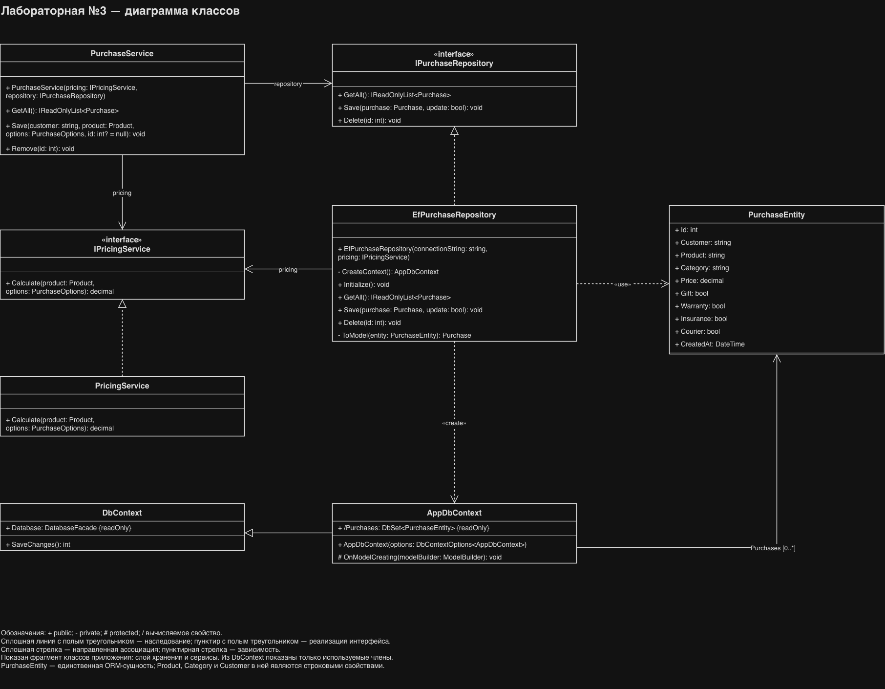
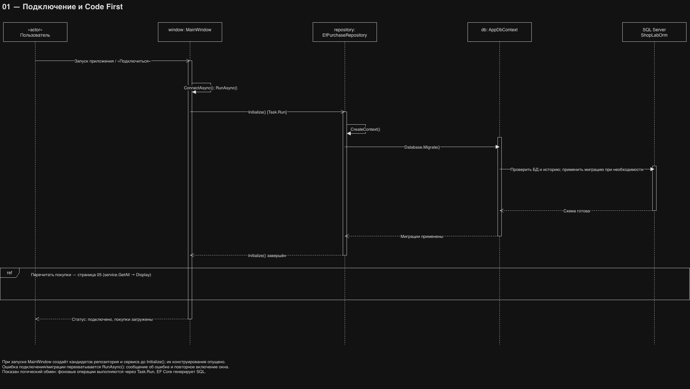

# Отчёт по лабораторной работе №3

Тема: ORM и Code First. Вариант 2 — «Покупка в интернет-магазине».

## Цель

Перевести приложение WPF с прямой работы через ADO.NET на Entity Framework Core: описать объектную модель, настроить контекст, создать схему Code First и выполнять CRUD через объекты и LINQ.

## ORM и контекст

Использована библиотека Microsoft.EntityFrameworkCore.SqlServer 8.0.22 для .NET 8. ORM сопоставляет PurchaseEntity таблице Purchases: свойства — столбцам, экземпляры — строкам. LINQ-запросы преобразуются провайдером в SQL с параметрами. DbContext управляет моделью и Change Tracker; SaveChanges сохраняет добавленные, изменённые и удалённые сущности.

На каждую операцию репозиторий создаёт и освобождает отдельный контекст. Для отображения списка используется AsNoTracking: прочитанные строки не нужно отслеживать. Для изменения сущность загружается в контекст с отслеживанием, после чего изменяются её свойства.

## Модель и схема

| Свойство PurchaseEntity | Тип SQL / правило |
| --- | --- |
| Id | int, первичный ключ, IDENTITY |
| Customer | nvarchar(80), обязательное, непустое имя |
| Product | nvarchar(100), обязательное |
| Category | nvarchar(40), обязательное |
| Price | decimal(12,2), больше нуля |
| Gift / Warranty / Insurance / Courier | bit, обязательные |
| CreatedAt | datetime2, значение по умолчанию SYSUTCDATETIME() |

Покупка хранит снимок товара и услуг. Отдельных таблиц клиентов и товаров нет, поэтому связей и внешних ключей нет. Такой выбор позволяет сохранить историческую цену независимо от каталога. Недостаток — повторение названий и категорий в строках; при развитии системы можно выделить сущности клиентов, заказов и позиций заказа.

Неизменяемые Product, PurchaseOptions и Purchase используются интерфейсом; изменяемая PurchaseEntity служит для ORM. Репозиторий выполняет преобразование между этими моделями.

## UML-диаграмма классов



Рисунок 1 — UML-диаграмма классов сервисного слоя и ORM, экспортированная из draw.io.

PurchaseService обращается к IPurchaseRepository для чтения, сохранения и удаления покупок, а к IPricingService — для расчёта стоимости. EfPurchaseRepository реализует IPurchaseRepository; PricingService реализует IPricingService. Репозиторий также использует расчёт при преобразовании сущности в модель интерфейса.

AppDbContext наследует DbContext и предоставляет вычисляемое свойство Purchases типа DbSet<PurchaseEntity>. Репозиторий создаёт отдельный контекст на каждую операцию. PurchaseEntity сопоставляется таблице Purchases. Связь контекста с коллекцией сущностей не обозначает внешний ключ между таблицами. На диаграмме показаны используемые члены DbContext; окно и модели интерфейса опущены.

У классов выделены секции имени, свойств и операций. Полый треугольник со сплошной линией обозначает наследование; с пунктирной — реализацию интерфейса. Направленные ассоциации обозначают доступ к зависимостям, пунктирные стрелки — использование и создание объектов.

## Диаграмма последовательности: подключение и Code First



Рисунок 2 — последовательность подключения приложения к SQL Server и применения миграций Code First.

На изображении показана первая страница диаграмм последовательности — «Подключение и Code First». Участники: пользователь, MainWindow, EfPurchaseRepository, AppDbContext и SQL Server с базой ShopLabOrm. Время направлено сверху вниз; вертикальный пунктир обозначает линию жизни, узкие прямоугольники — активации, пунктирные стрелки — ответы.

1. Запуск приложения или кнопка «Подключиться / обновить» вызывает ConnectAsync(), который выполняет операцию через RunAsync().
2. Окно создаёт кандидатов репозитория и сервиса; их конструирование опущено на рисунке. Через Task.Run вызывается Initialize().
3. Репозиторий создаёт AppDbContext методом CreateContext() и вызывает Database.Migrate().
4. EF Core проверяет базу и историю миграций, создаёт базу и применяет отсутствующие миграции при необходимости. При повторном подключении уже применённая миграция не выполняется заново.
5. После завершения Initialize() выполняется взаимодействие «Перечитать покупки», обозначенное блоком ref. В исходной многостраничной диаграмме это ссылка на страницу 05; её отдельный экспорт в этот отчёт не включён. Код вызывает service.GetAll(), затем Display(items) для показа списка и итоговой суммы.
6. Окно сохраняет рабочие ссылки на репозиторий и сервис, сбрасывает stale и показывает статус успешного подключения. При исключении RunAsync() выводит ошибку и снова включает окно.

Обозначение Task.Run отражает выполнение операций в фоновом потоке. SQL-запросы формирует EF Core. Эта диаграмма описывает начальное подключение; CRUD приведён в разделе «Основной код».

## Code First

AppDbContext.OnModelCreating задаёт конфигурацию из кода. Миграция 20261106000100_InitialCreate создаёт таблицу; её Down удаляет таблицу. Снимок фиксирует модель этой версии. При подключении вызывается Database.Migrate(); EF использует __EFMigrationsHistory для учёта применённых миграций.

Используется отдельная база ShopLabOrm. Данные предыдущей лабораторной в ShopLab не затрагиваются. Runtime-применение миграций удобно для учебной установки, но требует прав изменения схемы и одного первого запуска. Для промышленного развёртывания предпочтителен отдельный этап применения миграций.

## Основной код

Настройка SQL Server:

```csharp
new AppDbContext(new DbContextOptionsBuilder<AppDbContext>()
    .UseSqlServer(connectionString).Options);
```

Чтение через LINQ:

```csharp
return db.Purchases.AsNoTracking().OrderByDescending(p => p.Id)
    .ToList().Select(ToModel).ToArray();
```

OrderByDescending выполняется на сервере. После ToList данные материализованы; ToModel преобразует строки в модели для UI и рассчитывает стоимость.

Создание:

```csharp
var entity = new PurchaseEntity();
entity.Customer = purchase.Customer;
// Остальные поля также копируются из модели покупки.
db.Purchases.Add(entity);
db.SaveChanges();
```

Изменение:

```csharp
var entity = db.Purchases.SingleOrDefault(p => p.Id == purchase.Id)
    ?? throw new InvalidOperationException("Покупка уже удалена. Обновите список.");
entity.Customer = purchase.Customer;
// В репозитории обновляются товар, цена и все дополнительные параметры.
db.SaveChanges();
```

Удаление:

```csharp
var entity = db.Purchases.SingleOrDefault(p => p.Id == id)
    ?? throw new InvalidOperationException("Покупка уже удалена. Обновите список.");
db.Purchases.Remove(entity);
db.SaveChanges();
```

Полный код находится в Data/EfPurchaseRepository.cs. IPurchaseRepository позволяет сервису не зависеть от конкретного способа хранения.

## Интерфейс и ошибки

Сохранена компоновка макета Figma и элементы первой лабораторной: имя, категория, список товаров, флажки услуг, переключатели доставки, корзина, кнопки и статус. После добавления/изменения/удаления список повторно читается через ORM. Пустое имя проверяется до записи. SqlException, DbUpdateException и ошибки отсутствующей записи отображаются в статусе. Ограничения базы дополнительно защищают непустое имя и положительную цену.

## Проверка и скриншоты

Автопроверки проверяют цену, валидацию, контракт репозитория, генерацию SQL из миграции, перевод LINQ в SQL и соответствие снимка модели. Эти проверки не подключаются к настоящему серверу.

Сборка приложения завершилась без ошибок и предупреждений; перечисленные автоматические проверки прошли. Применение миграции и CRUD на настоящем SQL Server в этой среде не проверялись.

Ручная проверка на Windows ещё должна быть зафиксирована исполнителем:

| Сценарий | Ожидаемый результат |
| --- | --- |
| Первое подключение | ShopLabOrm, Purchases и __EFMigrationsHistory созданы |
| Пустое имя | Сообщение, INSERT не выполняется |
| Добавление и перезапуск | Покупка сохранилась |
| Изменение выбранной строки | Данные обновились, номер тот же |
| Подтверждение удаления | Строка отсутствует после перезапуска |
| Недоступный сервер | Сообщение об ошибке, приложение остаётся открытым |
| Стоимость 1 200 ₽ со всеми услугами | 2 786 ₽ с курьером |

После запуска добавьте реальные скриншоты:

1. Главное окно с добавленной покупкой.
2. Изменение покупки или ошибка ввода.
3. SSMS: таблица Purchases и история миграций.

Скриншоты не приложены автоматически: WPF и SQL Server требуют проверки на Windows.

## Сравнение с ADO.NET

| Критерий | Лабораторная №2: ADO.NET | Лабораторная №3: EF Core |
| --- | --- | --- |
| CRUD | SqlCommand, процедуры и параметры | Add/Remove, свойства и SaveChanges |
| Чтение | SqlDataReader, ручное сопоставление полей | LINQ и материализация сущностей |
| Схема | Ручной Setup.sql | Модель C# и миграции Code First |
| Контроль запросов | SQL задаётся явно | SQL формирует провайдер, его нужно анализировать |
| Объём служебного кода | Параметры и чтение столбцов вручную | Большую часть работы выполняет ORM |
| Производительность | Прямой контроль над запросом | Возможны лишняя загрузка данных и расходы отслеживания |
| Зависимости | Драйвер SqlClient | EF Core, SQL Server provider и драйвер |

## Выводы

ORM позволяет реализовать CRUD через типизированные объекты и LINQ, а Code First — хранить развитие схемы в миграциях. Разделение модели, сервиса, репозитория и интерфейса сохранилось при замене ADO.NET на EF Core. При этом ORM не отменяет знания SQL: необходимо проверять сформированные запросы, ограничивать объём выборки и учитывать права, миграции и конкурентные изменения. В этой версии чтение использует AsNoTracking; одновременное изменение одной покупки разрешается последним сохранением.

## Источники

- [Провайдер SQL Server для EF Core](https://learn.microsoft.com/en-us/ef/core/providers/sql-server/)
- [Применение миграций](https://learn.microsoft.com/en-us/ef/core/managing-schemas/migrations/applying)
- [Microsoft.EntityFrameworkCore.SqlServer 8.0.22](https://www.nuget.org/packages/Microsoft.EntityFrameworkCore.SqlServer/8.0.22)
- [Макет Figma](https://www.figma.com/design/I5L1IMwSMjMteNFit0vpaG?node-id=2-2)
